<picture>
  <source media="(prefers-color-scheme: dark)" srcset="docs/assets/banner-dark.svg">
  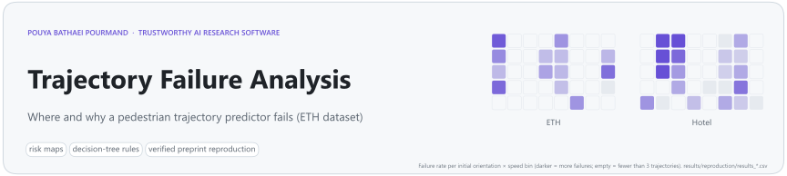
</picture>

<p align="center">
  <a href="https://github.com/pouyapd/trajectory-failure-analysis/actions/workflows/tests.yml"></a>
  
  <a href="https://doi.org/10.5281/zenodo.19513187"></a>
  
  
</p>

<p align="center">
  <a href="#research-question-and-method">Method</a> ·
  <a href="#reproduction-of-the-preprint">Reproduction</a> ·
  <a href="#additional-analyses-not-in-the-preprint">Additional analyses</a> ·
  <a href="#notes-on-the-preprint-text">Preprint notes</a> ·
  <a href="#reproduce-it">Reproduce it</a> ·
  <a href="#limitations">Limitations</a>
</p>

**When and why does a pedestrian trajectory predictor fail?** This repository holds a model-agnostic, interpretable failure analysis on two real-world scenes of the ETH dataset, together with its preprint, the original notebook and a tested pipeline. The pipeline re-creates every reported number from the pinned raw data and then tests how far those numbers can be taken.

> **Preprint:** P. Bathaei Pourmand, *Understanding Failure Modes in Pedestrian Trajectory Prediction via Interpretable Risk Analysis*, Zenodo, 2026. [doi:10.5281/zenodo.19513187](https://doi.org/10.5281/zenodo.19513187) · PDF: [`paper.pdf`](paper.pdf) (identical to the Zenodo file). Not peer-reviewed.

<p align="center">
  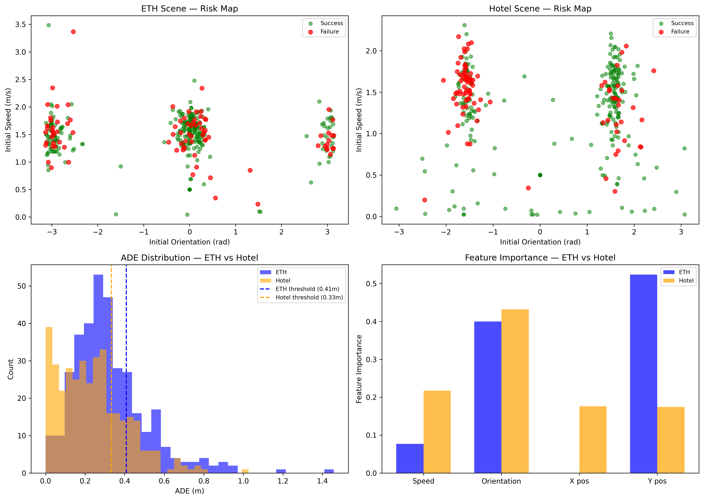
</p>
<p align="center"><sub>Preprint Figure 1 (unchanged): orientation–speed scatter of successes and failures in each scene, ADE distributions, and decision-tree feature importances.</sub></p>

## At a glance

| | |
|---|---|
| **Reproduced exactly** | all 16 values reported in the preprint (Table 1 and the quoted importances), from the pinned data; the original notebook's per-trajectory results equal the package's at full precision |
| **Finding** | initial orientation matters in both scenes, while the importance of position differs between them, so failure rules may not transfer between environments |
| **Limits shown by additional analyses** | the trees are not more accurate on held-out data than always predicting "success"; part of the positional signal in Hotel is consistent with an effect of the varying prediction horizon |
| **Scope** | one simple predictor (damped constant velocity), two scenes, 719 trajectories |

## Research question and method

The framework treats the predictor as a black box and asks which **initial conditions** of a pedestrian (walking speed, orientation, position) come with large prediction errors.

| Step | Setting |
|---|---|
| Data | ETH dataset, scenes *ETH* (353 trajectories) and *Hotel* (366), 2.5 Hz, positions in metres |
| Split | first half of each track observed; prediction for min(8, second-half length) steps |
| Predictor | damped constant velocity: the last observed velocity, multiplied by 0.98 before every step (called a simplified Social Force Model in the preprint) |
| Error | ADE and FDE over the predicted steps |
| Failure | ADE above the scene's 75th percentile (a relative label: the worst quarter of each scene) |
| Features | initial speed s₀, orientation φ₀, position x₀, y₀ |
| Explanation | binned risk maps (failure share per bin) and a decision tree per scene (depth ≤ 4, ≥ 10 samples per leaf) |

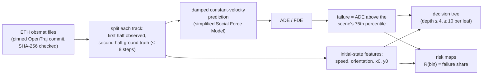

The predictor is model-agnostic in the sense that only its outputs are used; any function with the same signature can replace it (`tfa.pipeline.evaluate_scene(..., predict_fn=...)`).

## Reproduction of the preprint

`python scripts/reproduce.py` recomputes everything from the raw files. All 16 checked values match the preprint at its reported precision.

| Metric | ETH (preprint) | ETH (reproduced) | Hotel (preprint) | Hotel (reproduced) |
|---|:---:|:---:|:---:|:---:|
| Trajectories | 353 | 353 | 366 | 366 |
| Mean ADE (m) | 0.326 | 0.326 | 0.238 | 0.238 |
| Mean FDE (m) | 0.653 | 0.653 | 0.480 | 0.480 |
| Failure threshold τ (m) | 0.41 | 0.41 | 0.33 | 0.33 |
| Failure rate | 24.9 % | 24.9 % | 25.1 % | 25.1 % |
| Decision-tree accuracy (training data) | 79.3 % | 79.3 % | 82.0 % | 82.0 % |
| Importance of orientation φ0 | 0.400 | 0.400 | 0.432 | 0.432 |
| Other quoted importance | y0 0.523 | 0.523 | speed 0.218 | 0.218 |

**The original notebook gives the same results.** [`scripts/compare_notebook.py`](scripts/compare_notebook.py) runs the analysis cells of [`SafeTraj_ETH.ipynb`](SafeTraj_ETH.ipynb) unchanged (only the data path points to the pinned files). It finds the same 719 per-trajectory results, failure labels, thresholds and tree importances as the `tfa` package, with no difference at full precision (tolerance 1e-9; 6e-7 against the six-decimal CSVs). A test runs this comparison whenever the data are present, including in CI.

### Figures from the reproduced results

<p align="center">
  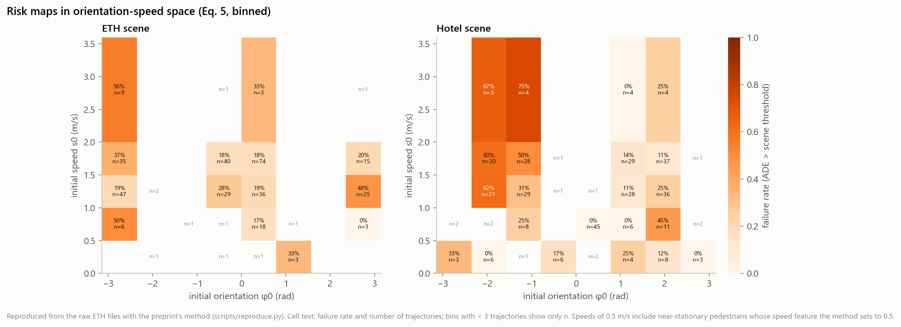
</p>
<p align="center"><sub>The binned risk map R(U_bin) of the preprint's Eq. 5, which the preprint shows as scatter plots. Each cell gives the failure rate and the number of trajectories; cells with fewer than 3 trajectories show only n. In the Hotel cell at orientation 0–0.79 rad and speed 0.5–1.0 m/s (0 %, n = 45), 43 trajectories are pedestrians with zero measured velocity: the method sets their speed feature to 0.5 m/s and their orientation becomes atan2(0, 0) = 0, which creates this cluster (see A4).</sub></p>

<p align="center">
  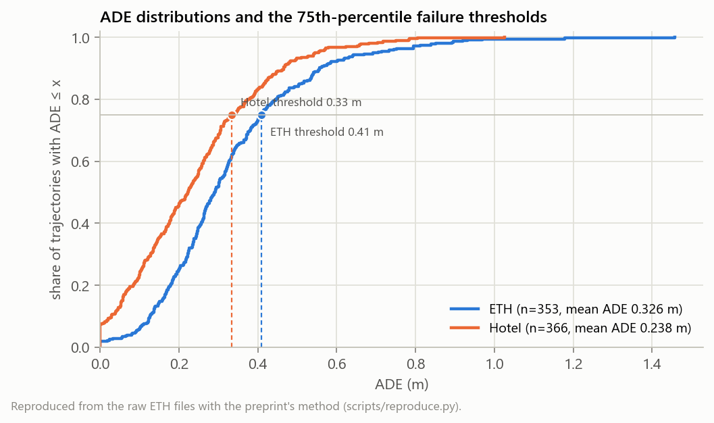
  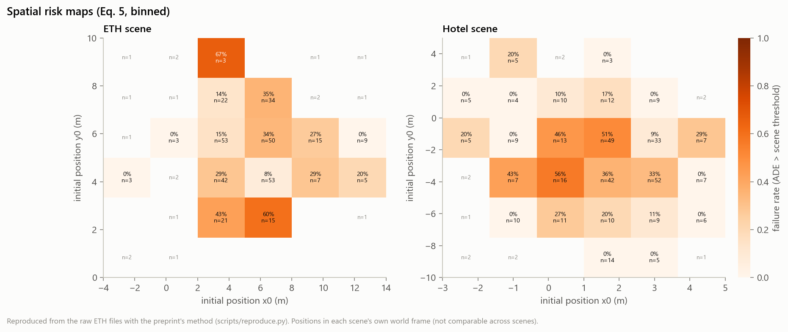
</p>
<p align="center"><sub>Cumulative ADE distributions (the failure thresholds sit at the 75th percentile of each scene) and spatial risk maps (each scene in its own coordinates).</sub></p>

<p align="center">
  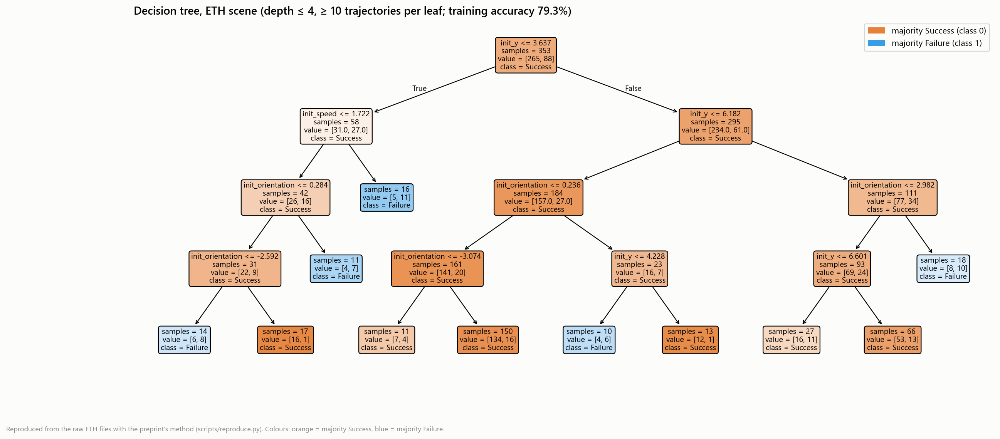
</p>
<p align="center"><sub>The ETH tree (identical to preprint Figure 2) with an explicit colour key. Failure rules extracted from it are listed in <a href="results/reproduction/tree_rules_eth.txt"><code>results/reproduction/tree_rules_eth.txt</code></a>.</sub></p>

## Additional analyses (not in the preprint)

These analyses use the same data, predictor and tree settings and change **one thing at a time**. They do not replace the preprint's numbers; they show how far those numbers can be taken. Run them with `python scripts/additional_analyses.py`; all values are in [`results/additional/summary.json`](results/additional/summary.json).

**A1. Held-out accuracy.** The preprint reports accuracy on the training data. With repeated stratified 5-fold cross-validation (20 repeats), the same trees are **not more accurate than always predicting "success"**: ETH 0.717 ± 0.044 vs. a majority baseline of 0.751; Hotel 0.743 ± 0.042 vs. 0.749. Balanced accuracy (mean of success and failure recall, 0.5 = chance) is 0.55 for ETH and 0.61 for Hotel: a weak but real signal for Hotel, close to chance for ETH. The rules therefore describe the evaluated trajectories; they are not validated as a run-time failure predictor.

<p align="center">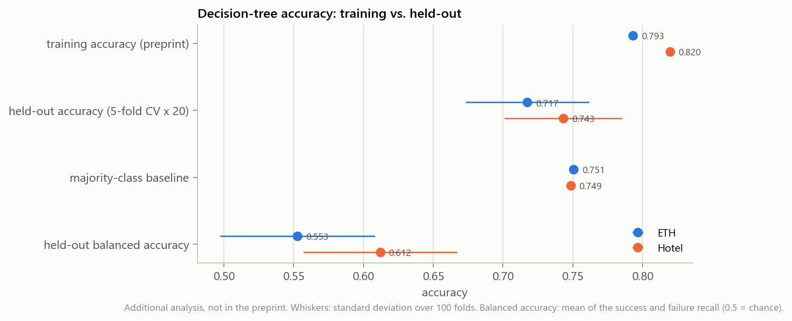</p>

**A2. Stability of the importances** (500 bootstrap resamples). In Hotel, orientation is the most important feature in 90 % of resamples, so "orientation matters" is robust there. In ETH the top feature is y0 in 47 % and orientation in 39 % of resamples: the two are close, and "y0 dominates" depends on the particular sample.

<p align="center">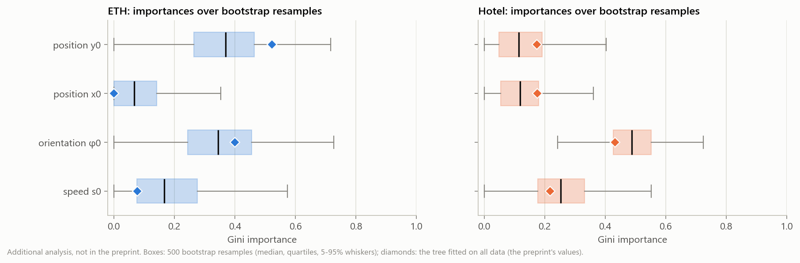</p>

**A3. Prediction horizon.** Each track is predicted for min(8, half its length) steps, so short tracks get short horizons, small ADEs and almost never fail. 89 % of ETH tracks have the full 8 steps, but only 55 % of Hotel tracks do; Hotel's failure rate rises from 0 % at 2 steps to 38 % at 8 steps. Repeating the analysis on full-horizon tracks only, Hotel's position importances drop from 0.18 / 0.17 to 0 (orientation 0.69, speed 0.31) and held-out balanced accuracy falls to 0.50. This is consistent with part of the positional signal in Hotel coming from track length rather than from where pedestrians walk.

<p align="center">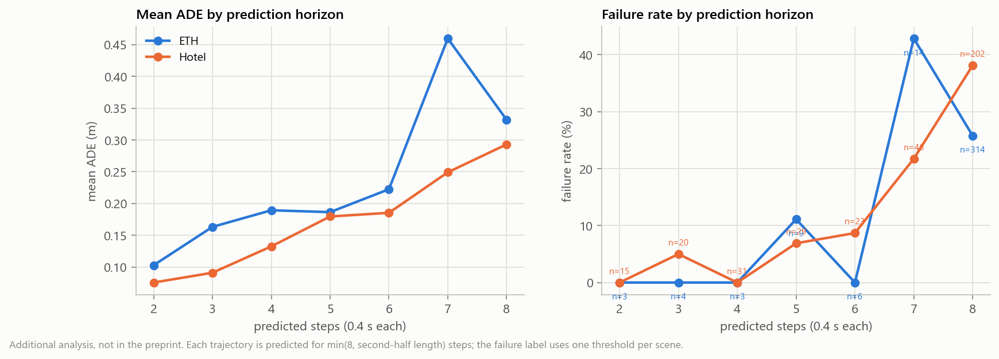</p>

**A4. Speed of near-stationary pedestrians.** When the last observed speed is below 0.01 m/s, the method sets the speed *feature* to 0.5 m/s (the prediction still uses the measured velocity). This affects 12 ETH and 43 Hotel trajectories. Keeping the measured speed leaves the ETH tree unchanged and changes Hotel's importances moderately (speed 0.23, orientation 0.47, x0 0.18, y0 0.12).

**A5. Failure threshold.** Moving the threshold from the 60th to the 90th ADE percentile changes which feature ranks first in ETH (y0, orientation or speed), while orientation stays first in Hotel at every threshold. Held-out accuracy beats the majority baseline only at lower thresholds: the 60th–65th percentile in both scenes and also the 70th in Hotel.

<p align="center">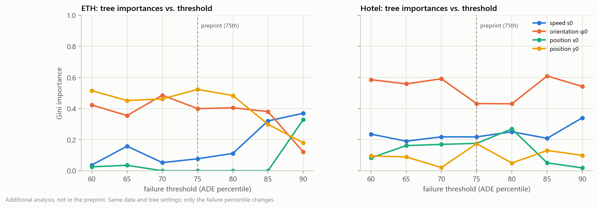</p>

## Notes on the preprint text

The preprint on Zenodo is not modified. This section records where its text differs from the code that produced its numbers; the code is the reference for every reproduced value. These points concern the description, not the reported numbers, which the code reproduces exactly.

- **Predictor.** Section 3.6 describes "a constant-velocity baseline (setting interaction forces to zero)". The notebook's predictor multiplies the velocity by 0.98 before every step (`vel = vel * 0.98`), so it is a damped constant-velocity model; its docstring says so, the preprint does not.
- **Prediction horizon.** Section 4.1 says the second half of each trajectory is the prediction target, and Eq. 2 averages the error over all remaining steps (`T − T_obs`). The code predicts at most 8 steps: the horizon is min(8, second-half length), so long tracks are evaluated on their first 8 future steps only. A3 shows that the horizon affects the results.
- **Role of speed.** The abstract says walking speed "plays a minor role". This holds for ETH (speed importance 0.077) but not for Hotel, where the preprint itself reports a speed importance of 0.218, more than either position coordinate.
- **"Position (0.176)" in Hotel.** Section 4.5 lists Hotel's importances as orientation 0.432, speed 0.218 and position 0.176. The value 0.176 is the x coordinate only; y has a further 0.174 (visible in Figure 1, bottom right), so position as a whole has 0.350.
- **Figure 2 colour key.** The caption (and a comment in the notebook) says blue nodes predict Success and orange nodes Failure. `sklearn.tree.plot_tree` colours class 0 (Success) orange and class 1 (Failure) blue, and the figure's own root node is orange with "class = Success". The colours are the reverse of the caption.
- **Track filter.** Section 4.1 says sequences shorter than 5 observations were removed; the code removes those shorter than 4 (3 ETH and 15 Hotel tracks have exactly 4 points). The reported counts (353, 366) correspond to the code.
- **Failure rate of about 25 %.** With the failure threshold at the 75th percentile, about 25 % of trajectories are failures by construction, so equal failure rates in the two scenes are expected rather than a finding.
- **Tree accuracy** is training accuracy (see A1), and the speed substitution for near-stationary pedestrians (A4) is not mentioned in the text.

## Reproduce it

```bash
git clone https://github.com/pouyapd/trajectory-failure-analysis.git
cd trajectory-failure-analysis
pip install -r requirements.txt                 # tested with Python 3.12

python scripts/download_data.py                 # 2 files, pinned commit, SHA-256 verified -> data/eth/
python scripts/reproduce.py                     # Table 1 check + figures; exit code 1 if any value differs
python scripts/additional_analyses.py           # A1-A5 (about a minute)
python scripts/compare_notebook.py              # original notebook cells vs. the tfa package
pytest                                          # 17 tests; the reproduction and notebook tests run when data/eth exists
```

`reproduce.py` ends with `ALL VALUES MATCH THE PREPRINT` and `compare_notebook.py` with `MATCH`; both exit with code 1 otherwise. GitHub Actions runs the download, the tests and the reproduction check on every push.

The original notebook was written for Google Colab. It clones the current OpenTraj repository rather than the pinned commit, and its last cell uses `google.colab` to download the figures. Running it in Colab has not been re-checked for this repository; its analysis cells are checked locally and in CI by `scripts/compare_notebook.py`.

Use the functions directly:

```python
from tfa.data import load_scene
from tfa.pipeline import evaluate_scene, label_failures
from tfa.analysis import fit_tree, cross_validated, leaf_rules

res, threshold = label_failures(evaluate_scene(load_scene("data/eth", "Hotel"), "Hotel"))
tree = fit_tree(res)                              # preprint setting
print(tree["train_accuracy"], cross_validated(res)["cv_accuracy_mean"])
for rule in leaf_rules(tree["model"], ["init_speed", "init_orientation", "init_x", "init_y"]):
    print(rule)
```

## Data

ETH pedestrian dataset, scenes *ETH* (`seq_eth`) and *Hotel* (`seq_hotel`): S. Pellegrini, A. Ess, K. Schindler, L. Van Gool, "You'll never walk alone: Modeling social behavior for multi-target tracking", ICCV 2009. Annotations at 2.5 Hz (every 6th / 10th video frame), positions in metres.

The files are read from the [OpenTraj](https://github.com/crowdbotp/OpenTraj) collection at commit `97ec1d5` (unchanged there since `8434e5e`, May 2020):

| Scene | File | SHA-256 |
|---|---|---|
| ETH | `datasets/ETH/seq_eth/obsmat.txt` | `d452ae2185ecb1164c2fdf31e75f6236f4c2ffc02c751a6b2ae921740cbc60d1` |
| Hotel | `datasets/ETH/seq_hotel/obsmat.txt` | `2b8577595204a6b780b80258fd50da35adb7293e3e06ad6f8e1b60965e7dde6e` |

The data is not redistributed in this repository. The loader checks column count, numeric values, duplicated rows and frame spacing (constant within every track in both files).

## What is verified and what is not

| Verified | Not verified |
|---|---|
| the 16 preprint values, from the pinned data (script, test, CI) | running the notebook in Google Colab |
| equality of the notebook's analysis cells and the package (script, test, CI) | any learned predictor (the pipeline accepts one; none was evaluated) |
| A1–A5 regenerate the committed `results/additional/` files | other datasets or scenes |
| 17 tests on Linux (CI) and Windows (local), Python 3.12 | other Python versions |

## Limitations

- One simple predictor (damped constant velocity). Failure patterns of learned predictors may differ.
- Two scenes with 353 and 366 trajectories. Findings are about these scenes and this predictor; they are not claimed to generalise to other environments.
- The failure label is relative (75th percentile within a scene), so it marks the worst quarter of predictions, not an absolute safety threshold.
- Held-out evaluation (A1) shows that the decision trees describe the data but do not predict failures better than a constant guess at the preprint's threshold.
- No robot or closed-loop experiment was run; the run-time monitoring uses discussed in the preprint are proposals.

## Repository map

```text
trajectory-failure-analysis/
├── paper.pdf                    # preprint (Zenodo, CC BY 4.0)
├── SafeTraj_ETH.ipynb           # original Colab notebook (unchanged)
├── comparison_scenes.png        # preprint Figures 1-3 (unchanged)
├── decision_tree_sfm.png
├── analysis_sfm.png
├── tfa/                         # data, pipeline, metrics, analysis, plots, config
├── scripts/                     # download_data.py, reproduce.py, additional_analyses.py, compare_notebook.py
├── results/
│   ├── reproduction/            # per-trajectory results, table1.csv, reproduction.json, tree rules
│   └── additional/              # summary.json, bootstrap importances
├── docs/                        # figures/ (generated by the scripts), assets/ (banner)
└── tests/                       # unit tests, full reproduction test, notebook comparison test
```

## Related projects

- [SafeTraj-Experiments](https://github.com/pouyapd/SafeTraj-Experiments): MSc thesis, the same black-box failure analysis for five neural trajectory predictors of a smart wheelchair (EU project REXASI-PRO).
- [SafeTraj-Prototype](https://github.com/pouyapd/SafeTraj-Prototype): toolkit with trajectory checks, novelty scores, risk maps and failure rules for any predictor.
- [SafeNav-RL](https://github.com/pouyapd/SafeNav-RL): reinforcement-learning navigation with a control-barrier-function safety filter (simulation).

## Citation

```bibtex
@misc{bathaeipourmand2026failure,
  author    = {Bathaei Pourmand, Pouya},
  title     = {Understanding Failure Modes in Pedestrian Trajectory Prediction via Interpretable Risk Analysis},
  year      = {2026},
  publisher = {Zenodo},
  doi       = {10.5281/zenodo.19513187},
  note      = {Preprint}
}
```

## Licensing status

No license has been chosen yet for the code and the notebook in this repository, so default copyright applies; choosing one is left to the author. The preprint (`paper.pdf`) is distributed under CC BY 4.0 (Zenodo record). The ETH data are not redistributed here: `scripts/download_data.py` fetches them from OpenTraj, and they remain under the terms of the original dataset. The per-trajectory results in `results/` and the figures are derived from those data. The fixture in `tests/fixtures/` is synthetic.
