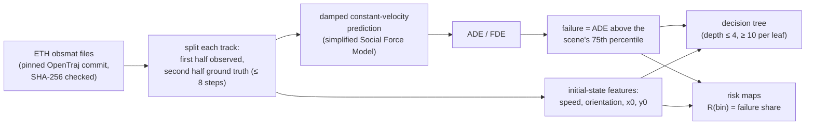

# Trajectory Failure Analysis — ETH Pedestrian Dataset

**When and why does a pedestrian trajectory predictor fail? A model-agnostic, interpretable failure analysis on two real-world scenes, with a reproducible pipeline that re-creates every number of the preprint from the raw data.**

[](https://doi.org/10.5281/zenodo.19513187)
[](https://colab.research.google.com/github/pouyapd/trajectory-failure-analysis/blob/main/SafeTraj_ETH.ipynb)

*Pouya Bathaei Pourmand — University of Genoa, Italy*

> **Preprint:** P. Bathaei Pourmand, *Understanding Failure Modes in Pedestrian Trajectory Prediction via Interpretable Risk Analysis*, Zenodo, 2026. [doi:10.5281/zenodo.19513187](https://doi.org/10.5281/zenodo.19513187) · PDF: [`paper.pdf`](paper.pdf) (identical to the Zenodo file). Not peer-reviewed.

<p align="center">
  
</p>
<p align="center"><em>Preprint Figure 1 (unchanged): orientation–speed scatter of successes and failures in each scene, ADE distributions, and decision-tree feature importances.</em></p>

---

## What this repository contains

| Part | Content |
|---|---|
| [`paper.pdf`](paper.pdf), [`SafeTraj_ETH.ipynb`](SafeTraj_ETH.ipynb), root PNG figures | the preprint, its original Colab notebook and figures — **unchanged** |
| [`tfa/`](tfa/) | the notebook's method as tested, reusable Python functions (data, predictor, ADE/FDE, failure labels, trees, risk maps) |
| [`scripts/`](scripts/) | pinned data download, a reproduction script that checks every reported number, and additional analyses |
| [`results/`](results/) | outputs of those scripts: per-trajectory results, `table1.csv`, decision-tree rules, `summary.json` |
| [`docs/figures/`](docs/figures/) | new figures generated from the reproduced results |

## Method



The predictor is model-agnostic in the sense that only its outputs are used; any function with the same signature can replace it (`tfa.pipeline.evaluate_scene(..., predict_fn=...)`).

## Results reported in the preprint — reproduced

`python scripts/reproduce.py` recomputes everything from the raw files. All 16 checked values match the preprint at its reported precision, and the per-trajectory results are identical to the original notebook's (719 rows).

| Metric | ETH (preprint) | ETH (reproduced) | Hotel (preprint) | Hotel (reproduced) |
|---|:---:|:---:|:---:|:---:|
| Trajectories | 353 | 353 | 366 | 366 |
| Mean ADE (m) | 0.326 | 0.326 | 0.238 | 0.238 |
| Mean FDE (m) | 0.653 | 0.653 | 0.480 | 0.480 |
| Failure threshold τ (m) | 0.41 | 0.41 | 0.33 | 0.33 |
| Failure rate | 24.9 % | 24.9 % | 25.1 % | 25.1 % |
| Decision-tree accuracy (training data) | 79.3 % | 79.3 % | 82.0 % | 82.0 % |
| Importance of orientation φ0 | 0.400 | 0.400 | 0.432 | 0.432 |
| Other quoted importance | y0 0.523 | 0.523 | speed 0.218 | 0.218 |

Key finding of the preprint: initial orientation is important in both scenes, while the importance of position differs between scenes, so failure rules may not transfer between environments.

### Figures from the reproduced results

<p align="center">
  
</p>
<p align="center"><em>The binned risk map R(U_bin) of the preprint's Eq. 5, which the preprint shows as scatter plots. Each cell gives the failure rate and the number of trajectories; cells with fewer than 3 trajectories show only n. In the Hotel cell at orientation 0–0.79 rad and speed 0.5–1.0 m/s (0 %, n = 45), 43 trajectories are pedestrians with zero measured velocity: the method sets their speed feature to 0.5 m/s and their orientation becomes atan2(0, 0) = 0, which creates this cluster (see A4).</em></p>

<p align="center">
  
  
</p>
<p align="center"><em>Left: cumulative ADE distributions; the failure thresholds sit at the 75th percentile of each scene. Right/below: spatial risk maps (each scene in its own coordinates).</em></p>

<p align="center">
  
</p>
<p align="center"><em>The ETH tree (identical to preprint Figure 2) with an explicit colour key. Failure rules extracted from it are listed in <a href="results/reproduction/tree_rules_eth.txt"><code>results/reproduction/tree_rules_eth.txt</code></a>.</em></p>

## Additional analyses (not in the preprint)

These analyses use the same data, predictor and tree settings and change **one thing at a time**. They do not replace the preprint's numbers; they show how far those numbers can be taken. Run them with `python scripts/additional_analyses.py`; all values are in [`results/additional/summary.json`](results/additional/summary.json).

**A1 — Held-out accuracy.** The preprint reports accuracy on the training data. With repeated stratified 5-fold cross-validation (20 repeats), the same trees are **not more accurate than always predicting "success"**: ETH 0.717 ± 0.044 vs. a majority baseline of 0.751; Hotel 0.743 ± 0.042 vs. 0.749. Balanced accuracy (mean of success and failure recall, 0.5 = chance) is 0.55 for ETH and 0.61 for Hotel: a weak but real signal for Hotel, close to chance for ETH. The rules therefore describe the evaluated trajectories; they are not validated as a run-time failure predictor.

<p align="center"></p>

**A2 — Stability of the importances** (500 bootstrap resamples). In Hotel, orientation is the most important feature in 90 % of resamples, so "orientation matters" is robust there. In ETH the top feature is y0 in 47 % and orientation in 39 % of resamples: the two are close, and "y0 dominates" depends on the particular sample.

<p align="center"></p>

**A3 — Prediction horizon.** Each track is predicted for min(8, half its length) steps, so short tracks get short horizons, small ADEs and almost never fail. 89 % of ETH tracks have the full 8 steps, but only 55 % of Hotel tracks do; Hotel's failure rate rises from 0 % at 2 steps to 38 % at 8 steps. Repeating the analysis on full-horizon tracks only, Hotel's position importances drop from 0.18 / 0.17 to 0 (orientation 0.69, speed 0.31) and held-out balanced accuracy falls to 0.50. This is consistent with part of the positional signal in Hotel coming from track length rather than from where pedestrians walk.

<p align="center"></p>

**A4 — Speed of near-stationary pedestrians.** When the last observed speed is below 0.01 m/s, the method sets the speed *feature* to 0.5 m/s (the prediction still uses the measured velocity). This affects 12 ETH and 43 Hotel trajectories. Keeping the measured speed leaves the ETH tree unchanged and changes Hotel's importances moderately (speed 0.23, orientation 0.47, x0 0.18, y0 0.12).

**A5 — Failure threshold.** Moving the threshold from the 60th to the 90th ADE percentile changes which feature ranks first in ETH (y0, orientation or speed), while orientation stays first in Hotel at every threshold. Held-out accuracy beats the majority baseline only at lower thresholds: the 60th–65th percentile in both scenes and also the 70th in Hotel.

<p align="center"></p>

## Notes on the preprint text (checked against the code)

These points concern the description, not the reported numbers, which the code reproduces exactly.

- **Figure 2 colour key.** The caption (and a comment in the notebook) says blue nodes predict Success and orange nodes Failure. `sklearn.tree.plot_tree` colours class 0 (Success) orange and class 1 (Failure) blue, and the figure's own root node is orange with "class = Success". The colours are the reverse of the caption.
- **Track filter.** Section 4.1 says sequences shorter than 5 observations were removed; the code removes those shorter than 4 (3 ETH and 15 Hotel tracks have exactly 4 points). The reported counts (353, 366) correspond to the code.
- **Failure rate of about 25 %.** With the failure threshold at the 75th percentile, about 25 % of trajectories are failures by construction, so equal failure rates in the two scenes are expected rather than a finding.
- **Tree accuracy** is training accuracy (see A1), and the speed substitution for near-stationary pedestrians (A4) is not mentioned in the text.

## Reproduce it

```bash
git clone https://github.com/pouyapd/trajectory-failure-analysis.git
cd trajectory-failure-analysis
pip install -r requirements.txt                 # Python 3.10+

python scripts/download_data.py                 # 2 files, pinned commit, SHA-256 verified -> data/eth/
python scripts/reproduce.py                     # Table 1 check + figures; exit code 1 if any value differs
python scripts/additional_analyses.py           # A1-A5 (about a minute)
pytest                                          # 16 tests; the reproduction test runs when data/eth exists
```

The original notebook runs unchanged in Google Colab (badge above): it clones OpenTraj and writes the root-level figures. A GitHub Actions workflow (`.github/workflows/tests.yml`) is set up to download the data, run the tests and the reproduction check.

Use the functions directly:

```python
from tfa.data import load_scene
from tfa.pipeline import evaluate_scene, label_failures
from tfa.analysis import fit_tree, cross_validated, leaf_rules

res, threshold = label_failures(evaluate_scene(load_scene("data/eth", "Hotel"), "Hotel"))
tree = fit_tree(res)                              # preprint setting
print(tree["train_accuracy"], cross_validated(res)["cv_accuracy_mean"])
for rule in leaf_rules(tree["model"], ["init_speed", "init_orientation", "init_x", "init_y"]):
    print(rule)
```

## Data

ETH pedestrian dataset, scenes *ETH* (`seq_eth`) and *Hotel* (`seq_hotel`): S. Pellegrini, A. Ess, K. Schindler, L. Van Gool, "You'll never walk alone: Modeling social behavior for multi-target tracking", ICCV 2009. Annotations at 2.5 Hz (every 6th / 10th video frame), positions in metres.

The files are read from the [OpenTraj](https://github.com/crowdbotp/OpenTraj) collection at commit `97ec1d5` (unchanged there since `8434e5e`, May 2020):

| Scene | File | SHA-256 |
|---|---|---|
| ETH | `datasets/ETH/seq_eth/obsmat.txt` | `d452ae2185ecb1164c2fdf31e75f6236f4c2ffc02c751a6b2ae921740cbc60d1` |
| Hotel | `datasets/ETH/seq_hotel/obsmat.txt` | `2b8577595204a6b780b80258fd50da35adb7293e3e06ad6f8e1b60965e7dde6e` |

The data is not redistributed in this repository. The loader checks column count, numeric values, duplicated rows and frame spacing (constant within every track in both files).

## Repository structure

```text
trajectory-failure-analysis/
├── paper.pdf                    # preprint (Zenodo, CC BY 4.0)
├── SafeTraj_ETH.ipynb           # original Colab notebook (unchanged)
├── comparison_scenes.png        # preprint Figures 1-3 (unchanged)
├── decision_tree_sfm.png
├── analysis_sfm.png
├── tfa/                         # data, pipeline, metrics, analysis, plots, config
├── scripts/                     # download_data.py, reproduce.py, additional_analyses.py
├── results/
│   ├── reproduction/            # per-trajectory results, table1.csv, reproduction.json, tree rules
│   └── additional/              # summary.json, bootstrap importances
├── docs/figures/                # figures generated by the scripts
└── tests/                       # unit tests + full reproduction test
```

## Limitations

- One simple predictor (damped constant velocity). Failure patterns of learned predictors may differ; the pipeline accepts any predictor, but none was evaluated here.
- Two scenes with 353 and 366 trajectories. Findings are about these scenes and this predictor; they are not claimed to generalise to other environments.
- The failure label is relative (75th percentile within a scene), so it marks the worst quarter of predictions, not an absolute safety threshold.
- Held-out evaluation (A1) shows that the decision trees describe the data but do not predict failures better than a constant guess at the preprint's threshold.
- No robot or closed-loop experiment was run; the run-time monitoring uses discussed in the preprint are proposals.

## Related projects

- [SafeTraj-Experiments](https://github.com/pouyapd/SafeTraj-Experiments) — MSc thesis: the same black-box failure analysis for five neural trajectory predictors of a smart wheelchair (EU project REXASI-PRO).
- [SafeTraj-Prototype](https://github.com/pouyapd/SafeTraj-Prototype) — toolkit with trajectory checks, novelty scores, risk maps and failure rules for any predictor.
- [SafeNav-RL](https://github.com/pouyapd/SafeNav-RL) — reinforcement-learning navigation with a control-barrier-function safety filter (simulation).

## Citation and license

```bibtex
@misc{bathaeipourmand2026failure,
  author    = {Bathaei Pourmand, Pouya},
  title     = {Understanding Failure Modes in Pedestrian Trajectory Prediction via Interpretable Risk Analysis},
  year      = {2026},
  publisher = {Zenodo},
  doi       = {10.5281/zenodo.19513187},
  note      = {Preprint}
}
```

The preprint is distributed under CC BY 4.0 (Zenodo record). A license for the code in this repository has not been chosen yet.
